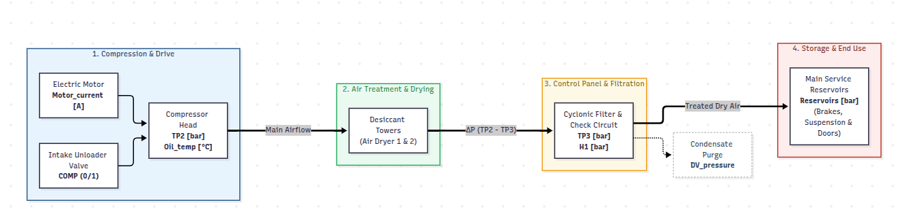

# Air production unit (APU) architecture, process physics, and telemetry profile

### System architecture and process thermodynamics

The auxiliary pneumatic system provides compressed air for passenger train braking, air suspension, pantograph control, and automated doors. The Air Production Unit (APU) combines an oil-injected reciprocating compressor with an adsorption desiccant air dryer assembly to supply conditioned, dry compressed air to the main storage reservoirs.

  

Process flow mapped to operational stages:

1. Compression and electromechanical drive
   When main reservoir pressure falls below the cut-in boundary (~8.5 bar), the pneumatic control unit opens the intake valve (solenoid signal `COMP = 0`, active-low logic). The three-phase AC induction motor draws electrical current to drive the reciprocating pistons. As air is compressed, cylinder discharge pressure climbs to ~10 bar at the compressor head (`TP2`). Compression friction and thermodynamic heat raise crankcase lubricant temperature (`Oil_temp`).

2. Air treatment and moisture adsorption
   Superheated, moisture-laden air leaves the compressor head and passes into dual adsorption desiccant towers (`TOWERS`). One tower strips water vapor under pressure, while the opposite tower purges retained moisture to the atmosphere using a small portion of dried air. Flow resistance across the desiccant beds is tracked by pressure drop across the panel ($\Delta P = \text{TP2} - \text{TP3}$).

3. Filtration, check valves, and condensate purge
   Dry air exits through a cyclonic particulate filter that captures oil aerosols and desiccant dust, monitored downstream at `TP3`. Non-return check valves isolate upstream delivery lines. Solenoid vent line pressure (`H1`) vents to atmosphere during active pumping and holds backpressure when idle. Accumulated condensate in drainage bowls vents periodically through the drain valve line (`DV_pressure`).

4. Reservoir storage and idle unloading
   Pressurized air enters the main storage reservoirs (`Reservoirs`), stabilizing between 8.5 bar and 10.0 bar. Once pressure reaches the upper cut-out threshold (~10.0 bar), the control unit switches `COMP` to `1` (unloaded idle). The motor de-energizes, the compressor head vents to atmospheric pressure (`TP2` ~0 bar), and downstream check valves hold reservoir charge intact until pneumatic consumption triggers the next pumping cycle.

---

### Facility and asset specifications

* Asset Type: Air Production Unit (APU) - Metro do Porto Light Rail Vehicle (LRV)
* Compressor Architecture: Oil-injected reciprocating piston compressor
* Primary Working Pressure: 8.5 bar (Cut-in) to 10.0 bar (Cut-out)
* Motor Rating: ~5.5 kW / 400V 3-phase AC induction motor
* Operational Duty Cycle: Intermittent service duty (~15% to 25% nominal operating ratio)

---

### Telemetry profile and data dictionary

The dataset consists of 15,169,480 high-frequency records (sampled at 1 Hz) collected between February and August 2020 by an on-board datalogger on an active passenger train APU, spanning 15 telemetry signals (7 analog, 8 digital).

| Variable | Signal type | Units | Operating range | Physical role |
| :---: | :---: | :---: | :---: | :--- |
| TP2 | Continuous | bar | -0.03 to 10.68 | Compressor head discharge pressure tracking active compression and venting |
| TP3 | Continuous | bar | 0.73 to 10.30 | Pneumatic control panel delivery pressure downstream of desiccant towers |
| H1 | Continuous | bar | -0.04 to 10.14 | Vent/isolation line pressure monitoring cyclonic separator discharge |
| DV_pressure | Continuous | bar | -0.03 to 9.84 | Pressure drop generated during drying tower purge and condensate venting |
| Reservoirs | Continuous | bar | 4.98 to 10.30 | Downstream storage reservoir pressure supplying train braking and doors |
| Motor_current | Continuous | A | 0.02 to 9.30 | Single-phase electrical current draw of the 3-phase compressor motor |
| Oil_temp | Continuous | °C | 15.40 to 89.05 | Crankcase lubricant temperature reflecting cumulative thermodynamic load |
| COMP | Binary | 0 or 1 | 0, 1 | Solenoid control valve state (0 = active pumping, 1 = unloaded idle) |
| DV_electric | Binary | 0 or 1 | 0, 1 | Electrical valve signal controlling compressor outlet and purge discharge |
| TOWERS | Binary | 0 or 1 | 0, 1 | Active tower selector defining drying tower versus regeneration tower |
| MPG | Binary | 0 or 1 | 0, 1 | Auxiliary pressure governor signal starting compressor under load |
| LPS | Binary | 0 or 1 | 0, 1 | Low-pressure safety switch activating when reservoir pressure falls below 7 bar |
| Pressure_switch | Binary | 0 or 1 | 0, 1 | Pressure sensor detecting exhaust discharge in the drying towers |
| Oil_level | Binary | 0 or 1 | 0, 1 | Crankcase float switch detecting nominal versus low lubricant levels |
| Caudal_impulse | Discrete | Pulses | Integer >= 0 | Volumetric flow pulses tracking air volume delivered to storage reservoirs |

---

### Official maintenance failure logs

The official maintenance history documents four critical failure episodes. All four episodes correspond to severe, prolonged air leaks that imposed extreme continuous thermal and mechanical stress on the compressor:

| Event | Start time | End time | Failure mode | Operational severity | Maintenance action |
| :---: | :---: | :---: | :---: | :---: | :--- |
| #1 | 2020-04-18 00:00 | 2020-04-18 23:59 | Air leak | Sustained thermal and mechanical stress | Component inspected and serviced |
| #2 | 2020-05-29 23:30 | 2020-05-30 06:00 | Air leak | High thermal rise, reduced idle intervals | Serviced on May 30 at 12:00 |
| #3 | 2020-06-05 10:00 | 2020-06-07 14:30 | Air leak | Severe multi-day duty cycle saturation | Serviced on June 8 at 16:00 |
| #4 | 2020-07-15 14:30 | 2020-07-15 19:00 | Air leak | Acute pressure loss and continuous pumping | Serviced on July 16 at 00:00 |

---

### Granular failure episodes from the MetroPT research literature

In addition to the major workshop work orders above, a forensic engineering review by railway domain experts documented twenty-one distinct APU failure episodes between April and July 2020 (Table II of the original research: Baptista et al., 2022). Many of these intermediate incidents were not recorded in real time by train drivers because the compressor masked the leak by pumping continuously, operating under extreme thermal and mechanical stress until physical failure forced depot intervention.

| Episode | Start time | End time | Duration (min) | Severity | Description / Mapping |
| :---: | :---: | :---: | :---: | :---: | :--- |
| **#1** | 2020-04-12 11:50 | 2020-04-12 23:30 | 700 | High | Unreported prolonged pumping incident |
| **#2** | 2020-04-18 00:00 | 2020-04-18 23:59 | 1440 | High | Major Workshop Failure #1 (Day 1) |
| **#3** | 2020-04-19 00:00 | 2020-04-19 01:30 | 90 | High | Major Workshop Failure #1 (Tail before repair) |
| **#4** | 2020-04-29 03:20 | 2020-04-29 04:00 | 40 | High | Intermediate pressure drop episode |
| **#5** | 2020-04-29 22:00 | 2020-04-29 22:20 | 20 | High | Short cyclic instability episode |
| **#6** | 2020-05-13 14:00 | 2020-05-13 23:59 | 599 | High | Unreported extended duty cycle run |
| **#7** | 2020-05-18 05:00 | 2020-05-18 05:30 | 30 | High | Brief intake pressure loss incident |
| **#8** | 2020-05-19 10:10 | 2020-05-19 11:00 | 50 | High | Early morning cyclic instability |
| **#9** | 2020-05-19 22:10 | 2020-05-19 23:59 | 109 | High | Onset of multi-stage pumping anomaly |
| **#10** | 2020-05-20 00:00 | 2020-05-20 20:00 | 1200 | High | Continuous 20-hour uncooled pumping run |
| **#11** | 2020-05-23 09:50 | 2020-05-23 10:10 | 20 | High | Rapid pressure transient event |
| **#12** | 2020-05-29 23:30 | 2020-05-29 23:59 | 29 | High | Major Workshop Failure #2 (Initial onset) |
| **#13** | 2020-05-30 00:00 | 2020-05-30 06:00 | 360 | High | Major Workshop Failure #2 (Active overnight leak) |
| **#14** | 2020-06-01 15:00 | 2020-06-01 15:40 | 40 | High | Post-repair unloader testing transient |
| **#15** | 2020-06-03 10:00 | 2020-06-03 11:00 | 60 | High | Precursor instability episode |
| **#16** | 2020-06-05 10:00 | 2020-06-05 23:59 | 839 | High | Major Workshop Failure #3 (Day 1) |
| **#17** | 2020-06-06 00:00 | 2020-06-06 23:59 | 1439 | High | Major Workshop Failure #3 (Day 2 continuous leak) |
| **#18** | 2020-06-07 00:00 | 2020-06-07 14:30 | 870 | High | Major Workshop Failure #3 (Day 3 until depot withdrawal) |
| **#19** | 2020-07-08 17:30 | 2020-07-08 19:00 | 90 | High | Intermediate thermal surge incident |
| **#20** | 2020-07-15 14:30 | 2020-07-15 19:00 | 270 | Medium | Major Workshop Failure #4 (88.8°C thermal plateau) |
| **#21** | 2020-07-17 04:30 | 2020-07-17 05:30 | 60 | High | High-pressure cycling anomaly |

Operational context:
* The **February – March 2020** operational window represents a predominantly nominal operating baseline (free of documented severe incidents), serving as the training partition for semi-supervised anomaly detection paradigms.
* All documented failures correspond to **prolonged air leaks and control instabilities**, manifested physically through continuous compressor duty cycles, eliminated rest times, degraded replenishment rates, and severe cumulative thermal buildup.
