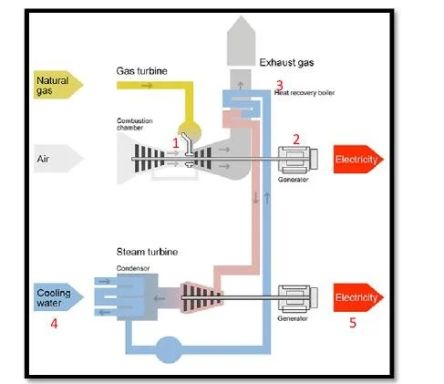

# Plant architecture, thermodynamics, and process telemetry

### Plant architecture and thermodynamics

A combined cycle power plant achieves high thermal efficiency by capturing waste heat from a gas turbine to drive a secondary steam turbine in a closed loop.

  

Process flow mapped to diagram steps:

1. Air compression and combustion (AT, AP, RH)
   Intake air enters the compressor section of the gas turbine and mixes with natural gas inside the combustion chamber (1). Ambient conditions dictate air density and mass flow at this point. Warmer air is less dense and reduces air mass flow as well as overall gas turbine power. Higher barometric pressure increases air density, which aids compressor efficiency. Moisture levels slightly alter air heat capacity and combustion kinetics.

2. Primary electricity generation
   The expanding hot combustion gases spin the turbine blades, turning the first generator (2) to produce the primary electrical stream.

3. Waste heat capture
   Instead of venting superheated exhaust gases into the air, the exhaust passes through a heat recovery boiler (3). Inside this unit, cold returning water boils into high-pressure steam.

4. Steam condensation and cooling circuit (V)
   After expanding through the steam turbine, low-pressure steam enters the condenser. Cooling water (4) circulates through the condenser to turn the steam back into liquid water before pumping it back to the boiler. A degraded vacuum or higher backpressure in this chamber resists steam expansion, whereas an optimal vacuum maximizes extraction efficiency.

5. Secondary generation and total output (PE)
   The steam drives the steam turbine connected to the secondary generator (5) without burning extra fuel. The combined output of both generators yields the final net hourly electrical output in megawatts.

---

### Facility specifications

The plant operates with a nominal generating capacity of 480 MW. It features two 160 MW ABB 13E2 gas turbines, two dual-pressure heat recovery steam generators, and one 160 MW ABB steam turbine.

---

### Dataset profile and data dictionary

The dataset consists of 9,568 hourly average observations collected over a 6-year period (2006–2011) from an operational base-load plant running at full capacity, with zero missing values.

| Variable | Role | Type | Units | Range | Physical role |
| :---: | :---: | :---: | :---: | :---: | :--- |
| AT | Feature | Continuous | °C | 1.81 – 37.11 | Primary driver of gas turbine air density and intake efficiency |
| V | Feature | Continuous | cm Hg | 25.36 – 81.56 | Steam turbine backpressure collected at the condenser where lower vacuum increases steam expansion efficiency |
| AP | Feature | Continuous | mbar | 992.89 – 1,033.30 | Atmospheric barometric pressure influencing compressor intake mass flow |
| RH | Feature | Continuous | % | 25.56 – 100.16 | Moist air density impacting combustion kinetics and heat absorption capacity |
| PE | Target | Continuous | MW | 420.26 – 495.76 | Net full-load hourly electrical power generated by the combined facility |
